<a href="https://www.victorstudios.org/en"></a>

<a href="https://www.victorstudios.org/en"><picture><source media="(prefers-color-scheme: dark)" srcset="assets/dark/l-site.svg"></picture></a>
<a href="https://www.instagram.com/vs_web3/"><picture><source media="(prefers-color-scheme: dark)" srcset="assets/dark/l-instagram.svg"></picture></a>
<a href="https://www.linkedin.com/in/72salman/"><picture><source media="(prefers-color-scheme: dark)" srcset="assets/dark/l-linkedin.svg"></picture></a>

<picture><source media="(prefers-color-scheme: dark)" srcset="assets/dark/now.svg"></picture>
  

<picture><source media="(prefers-color-scheme: dark)" srcset="assets/dark/s01.svg">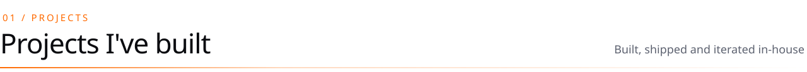</picture>

<a href="https://github.com/aayushh0-0/Rheon"><picture><source media="(prefers-color-scheme: dark)" srcset="assets/dark/p-rheon.svg">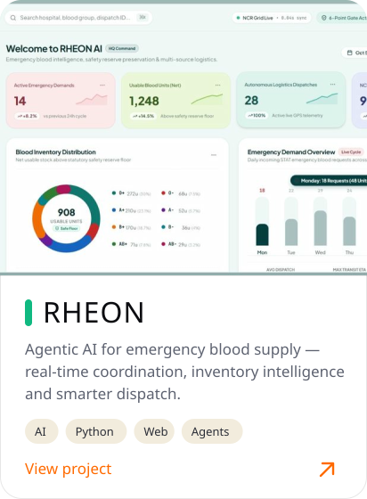</picture></a>
<a href="https://github.com/aayushh0-0/VYORA"><picture><source media="(prefers-color-scheme: dark)" srcset="assets/dark/p-vyora.svg">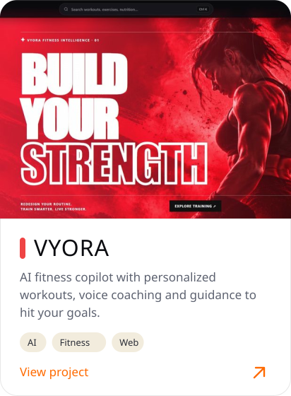</picture></a>
<a href="https://github.com/aayushh0-0/Natural-Language-to-SQL"><picture><source media="(prefers-color-scheme: dark)" srcset="assets/dark/p-querysql.svg">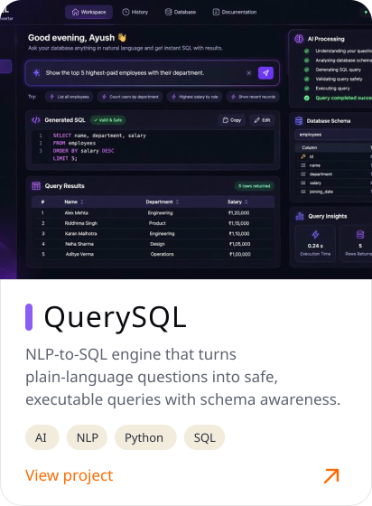</picture></a>

 

<picture><source media="(prefers-color-scheme: dark)" srcset="assets/dark/s03.svg"></picture>

<a href="https://www.behance.net/gallery/232965655/Medelz-Music-Streaming-Artist-Discovery-Platform"><picture><source media="(prefers-color-scheme: dark)" srcset="assets/dark/w-medelz.svg">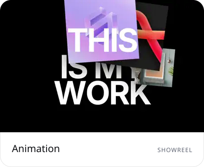</picture></a>
<a href="https://www.behance.net/gallery/232893223/Smart-Forum-Technology-Services-Website"><picture><source media="(prefers-color-scheme: dark)" srcset="assets/dark/w-smartforum.svg">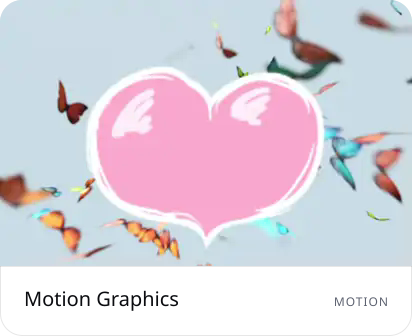</picture></a>
<a href="https://www.behance.net/gallery/232892185/SatHoller-NFT-Auction-Bidding-Platform"><picture><source media="(prefers-color-scheme: dark)" srcset="assets/dark/w-satholler.svg">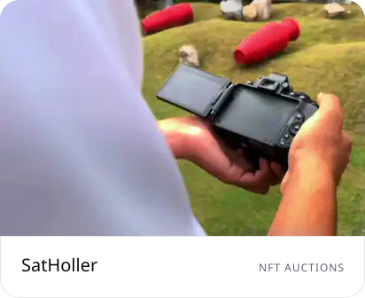</picture></a>

<a href="https://www.behance.net/gallery/232883891/MetaAdsFirm-Web3-Metaverse-Smart-Contract-Solutions"><picture><source media="(prefers-color-scheme: dark)" srcset="assets/dark/w-metaadsfirm.svg">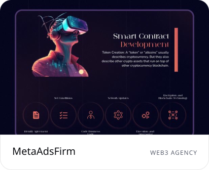</picture></a>
<a href="https://www.behance.net/gallery/232881881/The-Black-Momento"><picture><source media="(prefers-color-scheme: dark)" srcset="assets/dark/w-blackmomento.svg">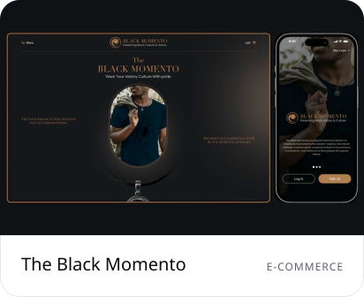</picture></a>
<a href="https://www.behance.net/gallery/232882337/Blckbuster-Digital-Marketplace-for-Movie-Rights"><picture><source media="(prefers-color-scheme: dark)" srcset="assets/dark/w-blckbuster.svg">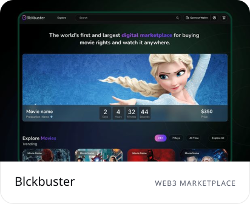</picture></a>

 

<picture><source media="(prefers-color-scheme: dark)" srcset="assets/dark/s04.svg">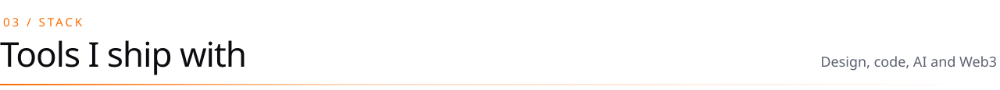</picture>

<picture><source media="(prefers-color-scheme: dark)" srcset="assets/dark/stack.svg"></picture>
  

<picture><source media="(prefers-color-scheme: dark)" srcset="assets/dark/s05.svg">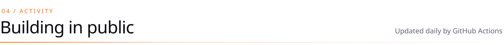</picture>

<picture><source media="(prefers-color-scheme: dark)" srcset="https://raw.githubusercontent.com/aayushh0-0/aayushh0-0/output/snake-dark.svg"></picture>
  

<a href="mailto:ayushrawat24070@gmail.com?subject=Project%20Inquiry">
</a>

<a href="mailto:ayushrawat24070@gmail.com?subject=Project%20Inquiry"><strong>📧 ayushrawat24070@gmail.com</strong></a>

<!-- Graphics are generated by tools/build.py in the Victor Studios palette. -->
